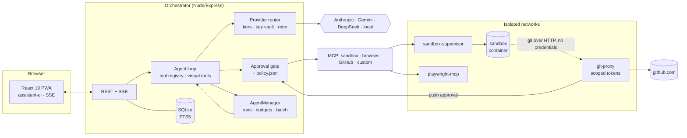

# EverythingApp

[](https://github.com/prod-explore/EverythingApp/actions/workflows/ci.yml)


A **self-hosted, bring-your-own-key AI workspace**: multi-provider chat, a sandboxed code agent that can browse the web and work with Git, multi-agent delegation with cost tiers, and a human-in-the-loop inbox — designed so that the *model is never trusted*, only the action layer is.


<table>
<tr>
<td width="50%"><br><sub>Agents ask blocking questions (choices, free text, forms) or park them in the inbox.</sub></td>
<td width="50%"><br><sub>Workers keep their transcript; finished agents stay under <i>Completed</i> and can be resumed.</sub></td>
</tr>
<tr>
<td><br><sub>SQLite FTS5 search over every message (⌘/Ctrl+K).</sub></td>
<td><br><sub>Slash commands in the composer.</sub></td>
</tr>
</table>

<p align="center"></p>

## Highlights

| Area | What it does |
|---|---|
| **Providers** | Anthropic, Gemini, DeepSeek, MindGate (local) and any OpenAI-compatible endpoint. One canonical Anthropic-shaped message format; an adapter translates the rest. Keys are AES-256-GCM encrypted at rest. |
| **Cost tiers** | `free → cheap → standard → strong`. Chats default to the free tier, workers cannot out-rank their parent, background chores (titles, daily digest) never leave `free`. |
| **Agents** | `spawn_agent` / `wait_agents` / `send_message`. Per-tree budgets, depth and spawn limits, kill switch. Finished workers can be resumed with a follow-up. |
| **Batch** | Plain chat turns can be queued via the Batch API; **tool-using workers** run as a chain of one-request batches (every step −50 %, tools execute locally behind the approval gate). |
| **Sandbox** | Per-project Docker container, no secrets, no `docker.sock`. Files explorer + editor with a checkpoint before every edit, rollback, Source Control, GitHub. |
| **Browser** | Playwright agent with domain/JS policy, SSRF guard and a quarantined extraction model; live view in the UI. |
| **Human in the loop** | Approval gate (inline cards), Gazeta inbox (blocking and async questions, reports, urgent → Web Push), `policy.json` for always-allow / always-block. |
| **UX** | FTS5 search, Markdown/JSON export, message branching, quote-selection, slash commands, PWA, WCAG-AA clean (axe: 0 violations at 1440×900 and 390×844). |

## Architecture



Packages: `cli` (orchestrator), `web` (UI), `sandbox-supervisor` + `sandbox-mcp` (container lifecycle and its MCP tools), `playwright-mcp` (browser agent), `git-proxy` (the only thing that ever sees a GitHub token), `tools/mock-llm` (deterministic fake model used by E2E and the screenshots above).

## Security model

The model is treated as an untrusted component. The boundary is the **action layer**, not the prompt.

1. **Approval gate** – every tool call with a side effect becomes an approval card; grants are scoped (this call / this project / this prefix). Shell commands go through a policy engine (`strict`, `allowlist`, `auto-in-sandbox`); destructive patterns are always blocked.
2. **No secrets in the sandbox** – the container has no API keys, no `docker.sock`, no database. Git goes through `git-proxy`, which holds the token, mints short-lived scoped tokens and asks a human before any push to a protected branch.
3. **Deterministic filter before any LLM** – the browser's observations are sanitised by code first; the optional quarantine model only ever sees already-filtered text and has no tools.
4. **Sessions** – password login, HttpOnly cookie; no token in `localStorage` or URLs. WebSocket/SSE accept the cookie only (cross-origin upgrades are rejected).
5. **Audit log** – approvals, grants, pushes and file edits are recorded.
6. **Policy as a file** – always-allow / always-block prefixes and known domains live in `policy.json` (hot-reloaded), not in a UI an agent could be talked into editing. Details in [ADR 0002](docs/adr/0002-policy-file-not-ui.md).

## Quickstart (no Docker, no API key)

Runs the whole UI against the deterministic mock model:

```bash
git clone https://github.com/prod-explore/EverythingApp && cd EverythingApp
(cd cli && npm ci && npm run build)
(cd web && npm ci && npx vite build)

node tools/mock-llm/server.mjs &                      # fake OpenAI-compatible model on :4010
cd cli
SERVER_AUTH_TOKEN=dev SERVER_PASSWORD=dev \
KEY_VAULT_SECRET=$(openssl rand -hex 32) \
MINDGATE_BASE_URL=http://127.0.0.1:4010/v1 PORT=3000 node dist/server.js
```

Open <http://localhost:3000>, log in with `dev`, then **Settings → Models → MindGate**: save any key and pick the `flash` model. Try `ask: which database?`, `report`, `spawn`, `long`.

### Full stack (sandbox, browser, git)

```bash
cp .env.example .env     # set KEY_VAULT_SECRET, SERVER_AUTH_TOKEN, MCP_API_KEY, GIT_PROXY_ADMIN_TOKEN, DOCKER_GID
docker build -t everything-sandbox:latest ./sandbox-supervisor/sandbox-image/
docker compose up --build
```

Deployment notes for a Raspberry Pi (egress guard, Nginx + HTTPS) are in [`deploy/`](deploy).

## Development

```bash
cd cli && npm test            # 307 tests (node:test, in-memory SQLite, fake providers)
cd git-proxy && npm test      #  40
cd sandbox-mcp && npm test    #  18
cd sandbox-supervisor && npm test  # 78
cd playwright-mcp && npm test #  250
cd web && npx tsc -b && npx vite build
```

CI runs all of the above on every push. The browser E2E (Playwright against the mock stack) checks the main flows plus console errors at 1440×900 and 390×844.

## Design decisions

Short ADRs in [`docs/adr`](docs/adr): canonical message format, policy file, sandbox/Git credentials, cost tiers, batch for tool workers, session cookies, lazy FTS5 index.

## License

[MIT](LICENSE)
