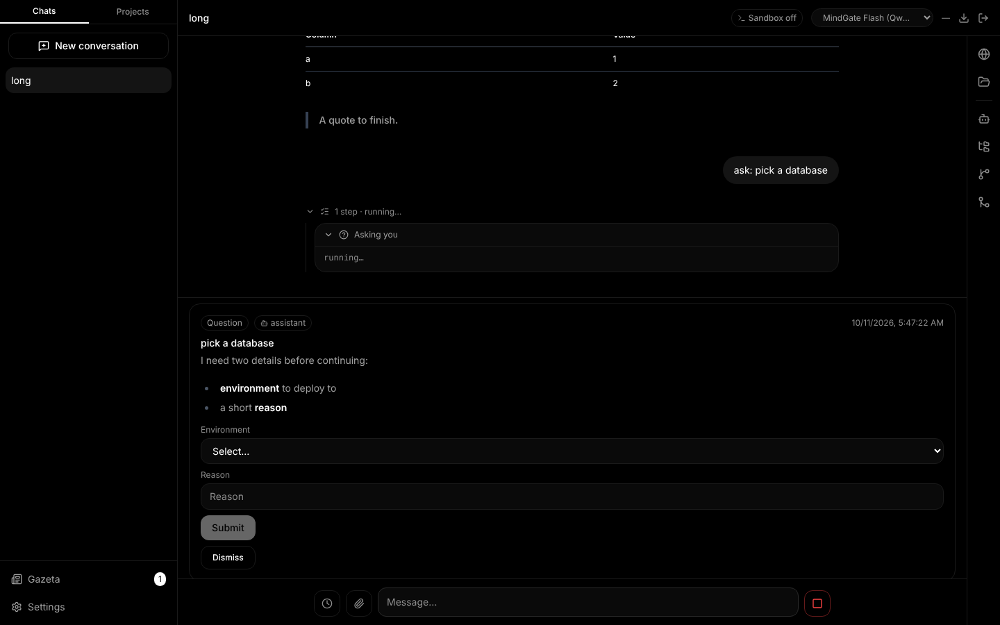
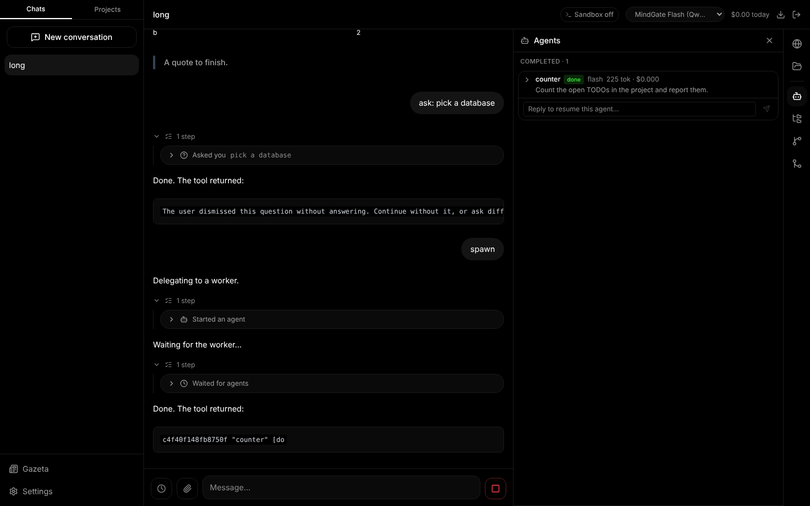
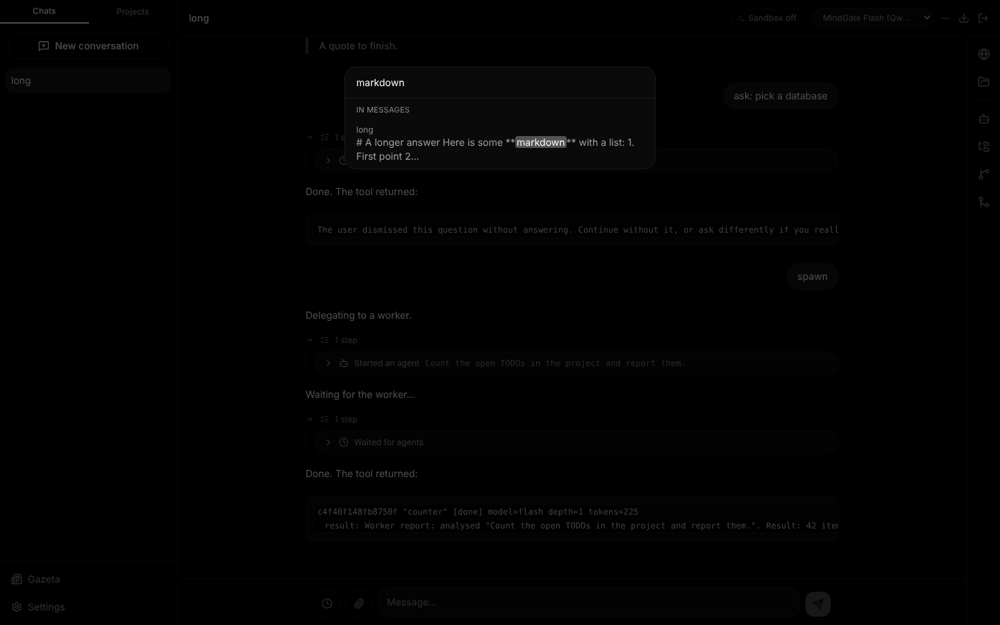
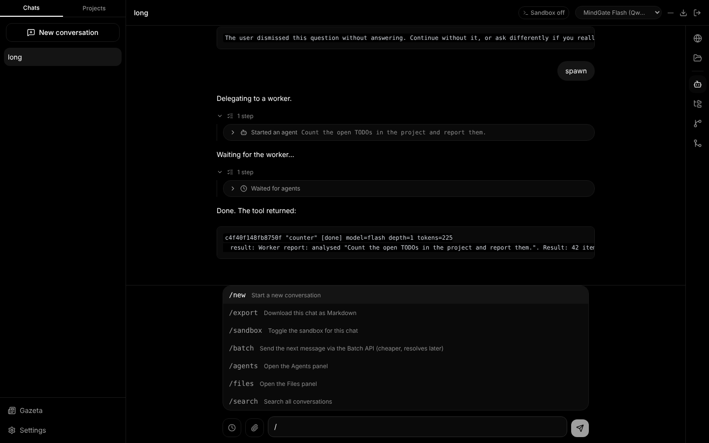
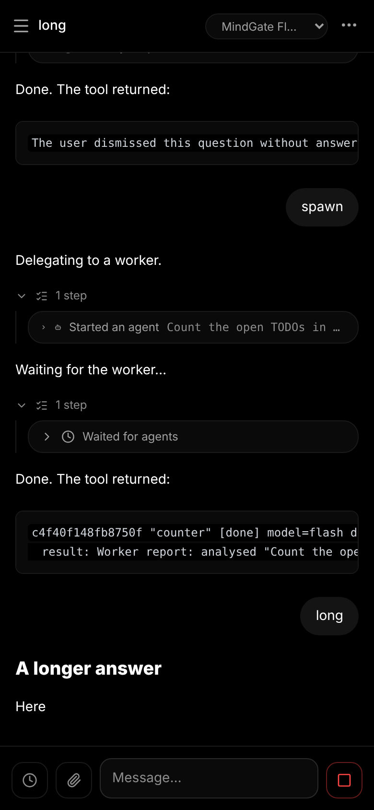
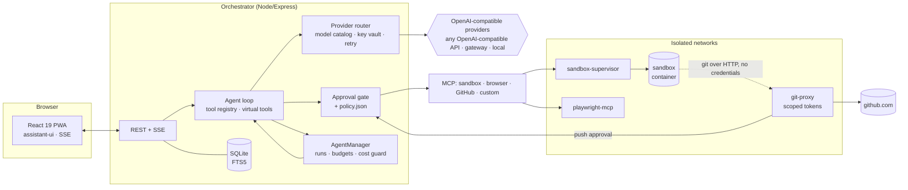

# EverythingApp

[](https://github.com/prod-explore/EverythingApp/actions/workflows/ci.yml)


A **self-hosted, bring-your-own-key AI workspace**: multi-provider chat, a sandboxed code agent that can browse the web and work with Git, multi-agent delegation with a free-model cost guard, and a human-in-the-loop inbox — designed so that the *model is never trusted*, only the action layer is.


<table>
<tr>
<td width="50%"><br><sub>Agents ask blocking questions (choices, free text, forms) or park them in the inbox.</sub></td>
<td width="50%"><br><sub>Workers keep their transcript; finished agents stay under <i>Completed</i> and can be resumed.</sub></td>
</tr>
<tr>
<td><br><sub>SQLite FTS5 search over every message (⌘/Ctrl+K).</sub></td>
<td><br><sub>Slash commands in the composer.</sub></td>
</tr>
</table>

<p align="center"></p>

## Highlights

| Area | What it does |
|---|---|
| **Providers** | One OpenAI-compatible format for everything: a provider is just *base URL + key* — OpenAI, OpenRouter, a gateway such as MindGate, a LAN server all go through the same “Add provider” form, and the app has no code that depends on who the provider is. Models are discovered from `GET {base}/models` (with `kind` and free-form `tags`: `free`, `coder`, `reasoning`…) and can be edited per model. Internally one block-based message format of its own (no vendor SDK); the adapter translates. Models without tool calls are not supported. Thinking models show their reasoning in a collapsible block. The app keeps no prices — usage is counted in tokens, money is the gateway's job. Keys are AES-256-GCM encrypted at rest. |
| **Model slots & cost guard** | Pick a chat default, a helper (titles, digest), an agent model and an escalation model. A chat on a `free` model can only start `free` workers unless “Allow agents to use paid models” is on. The orchestrator gets a generated list of the installed models and their tags to choose from. |
| **Agents** | `spawn_agent` / `wait_agents` / `send_message`. Per-tree budgets, depth and spawn limits, kill switch. Finished workers can be resumed with a follow-up. |
| **Sandbox** | Every chat has one (a project's chats share theirs): a Docker container with no secrets and no `docker.sock`. Files explorer (read-only preview, pencil to edit, pins at the top for what you want at hand) with a checkpoint before every edit, rollback, Source Control and GitHub in any chat. |
| **Web access** | `web_search` (SearXNG or Brave, set in Settings → Web) and `web_fetch` (page → markdown, no JavaScript), plus a Playwright browser agent with live view. `web_fetch` opens addresses from your message or from search results freely (as in Claude) and asks per domain for any URL the model composed itself; the browser asks **once per domain** — Allow once / this chat / always — like Antigravity's browser agent; private networks are never reachable. No model sits between a page and the agent. |
| **Chat functions** | `read_file` / `edit_file` / `write_file` (text files are edited without asking — a checkpoint is taken every turn), task list the model keeps (`todo_write`), plan proposals (the model proposes, you approve, then it works), reasoning-effort control, `AGENTS.md` in the project workspace (`/init` has the assistant write it) and custom instructions, a context meter with automatic and manual compaction (older messages become a summary for the model; they stay visible), and plain-language errors with the right recovery button. |
| **Ghost mode** | A chat or project that never leaves the machine: only models marked **local** (a MindGate node, or a LAN server you flagged), no web or browser tools, local-only helper and agents. Chosen when it is created and impossible to change afterwards — enforced by the database itself ([ADR 0013](docs/adr/0013-ghost-mode.md)). |
| **Human in the loop** | Approval gate (inline cards), Gazeta inbox (blocking and async questions, reports), `policy.json` for always-allow / always-block. |
| **UX** | FTS5 search, Markdown/JSON export, message branching, quote-selection, slash commands, PWA, WCAG-AA clean (axe: 0 violations at 1440×900 and 390×844). |

## Architecture



Packages: `cli` (orchestrator), `web` (UI), `sandbox-supervisor` + `sandbox-mcp` (container lifecycle and its MCP tools), `playwright-mcp` (browser agent), `git-proxy` (the only thing that ever sees a GitHub token), `tools/mock-llm` (deterministic fake model used by E2E and the screenshots above).

## Security model

The model is treated as an untrusted component. The boundary is the **action layer**, not the prompt.

1. **Approval gate** – every tool call with a side effect becomes an approval card; grants are scoped (this call / this project / this prefix). Shell commands go through a policy engine (`strict`, `allowlist`, `auto-in-sandbox`); destructive patterns are always blocked.
2. **No secrets in the sandbox** – the container has no API keys, no `docker.sock`, no database. Git goes through `git-proxy`, which holds the token, mints short-lived scoped tokens and asks a human before any push to a protected branch.
3. **Untrusted web content, no model in between** – pages and search results are sanitised by code (invisible Unicode stripped), wrapped as untrusted data and scored by a deterministic injection heuristic; a flagged page makes every later effectful call ask again. A model-composed URL needs your approval per domain, so reading a file and sending it to a new site needs a click ([ADR 0012](docs/adr/0012-web-access.md)).
4. **Sessions** – password login, HttpOnly cookie; no token in `localStorage` or URLs. WebSocket/SSE accept the cookie (or a Bearer header) only (cross-origin upgrades are rejected).
   **Service secrets** – every service-to-service token (`SUPERVISOR_TOKEN`, `MCP_API_KEY`, `PLAYWRIGHT_MCP_API_KEY`, `GIT_PROXY_ADMIN_TOKEN`, `SERVER_AUTH_TOKEN`) must be generated; services refuse to start with a placeholder or a short value. The nginx example blocks `/internal/*`.
5. **Audit log** – approvals, grants, pushes and file edits are recorded.
   **Ghost chats** – private material stays on local models and local tools; the flag cannot be switched off ([ADR 0013](docs/adr/0013-ghost-mode.md)).
6. **Policy as a file** – always-allow / always-block prefixes and known domains live in `policy.json` (hot-reloaded), not in a UI an agent could be talked into editing. Details in [ADR 0002](docs/adr/0002-policy-file-not-ui.md).

## Quickstart (no Docker, no API key)

Runs the whole UI against the deterministic mock model:

```bash
git clone https://github.com/prod-explore/EverythingApp && cd EverythingApp
(cd cli && npm ci && npm run build)
(cd web && npm ci && npx vite build)

node tools/mock-llm/server.mjs &                      # fake OpenAI-compatible model on :4010
cd cli
SERVER_AUTH_TOKEN=$(openssl rand -hex 32) SERVER_PASSWORD=dev \
KEY_VAULT_SECRET=$(openssl rand -hex 32) \
MINDGATE_BASE_URL=http://127.0.0.1:4010/v1 PORT=3000 node dist/server.js
```

Open <http://localhost:3000>, log in with the password `dev`, then **Settings → Models → + MindGate** (the base URL is pre-filled from `MINDGATE_BASE_URL`): paste any key; the mock's models appear after the model list loads (it reports them as local, so the ghost button works too). Try `ask: which database?`, `report`, `spawn`, `long`.

### Full stack (sandbox, browser, git)

```bash
cp .env.example .env     # fill in DOCKER_GID and every secret (openssl rand -hex 32): KEY_VAULT_SECRET, SERVER_AUTH_TOKEN,
                         # MCP_API_KEY, PLAYWRIGHT_MCP_API_KEY, SUPERVISOR_TOKEN, GIT_PROXY_ADMIN_TOKEN
docker build -t everything-sandbox:latest ./sandbox-supervisor/sandbox-image/
docker compose up --build
```

Deployment notes for a Raspberry Pi (egress guard, Nginx + HTTPS) are in [`deploy/`](deploy).

**Backups.** `deploy/backup.sh [dir] [keep]` takes a consistent copy of the database from the running stack (cron it); restoring is `db-backup.js restore <file> --yes` with the server stopped. The copy holds all chats and the encrypted provider keys — keep `KEY_VAULT_SECRET` too, and encrypt the file before it leaves the machine. Usage/audit rows older than `RETENTION_MONTHS` (12) are removed daily. Details: [ADR 0014](docs/adr/0014-data-lifecycle.md).

## Development

```bash
cd cli && npm test            # 476 tests (node:test, in-memory SQLite, fake providers)
cd git-proxy && npm test      #  40
cd sandbox-mcp && npm test    #  18
cd sandbox-supervisor && npm test  # 83
cd playwright-mcp && npm test #  242
cd web && npx tsc -b && npx vite build
```

CI runs all of the above on every push, plus `npm audit` (runtime dependencies), a Docker build of every image, CodeQL and a secret scan. The browser E2E (Playwright against the mock stack) checks the main flows plus console errors at 1440×900 and 390×844.

## Design decisions

Providers, model discovery, slots and the cost guard are documented in [`docs/providers.md`](docs/providers.md). Short ADRs in [`docs/adr`](docs/adr): canonical message format, policy file, sandbox/Git credentials, session cookies, lazy FTS5 index, the unified provider catalog (which supersedes the earlier cost-tier and batch-worker decisions), context management and chat functions, [ADR 0011](docs/adr/0011-hardening.md) (service secrets, supervisor token, deployment hardening) and [ADR 0012](docs/adr/0012-web-access.md) (web search/fetch, per-domain approval), [ADR 0013](docs/adr/0013-ghost-mode.md) (ghost mode) and [ADR 0014](docs/adr/0014-data-lifecycle.md) (schema versions, backups, retention).

## License

[MIT](LICENSE)
